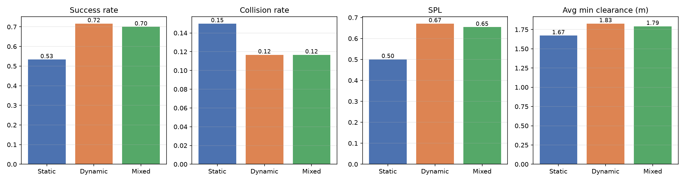
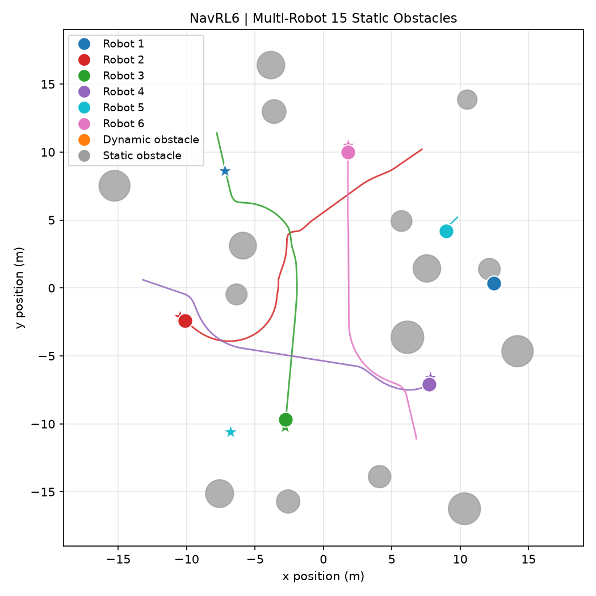
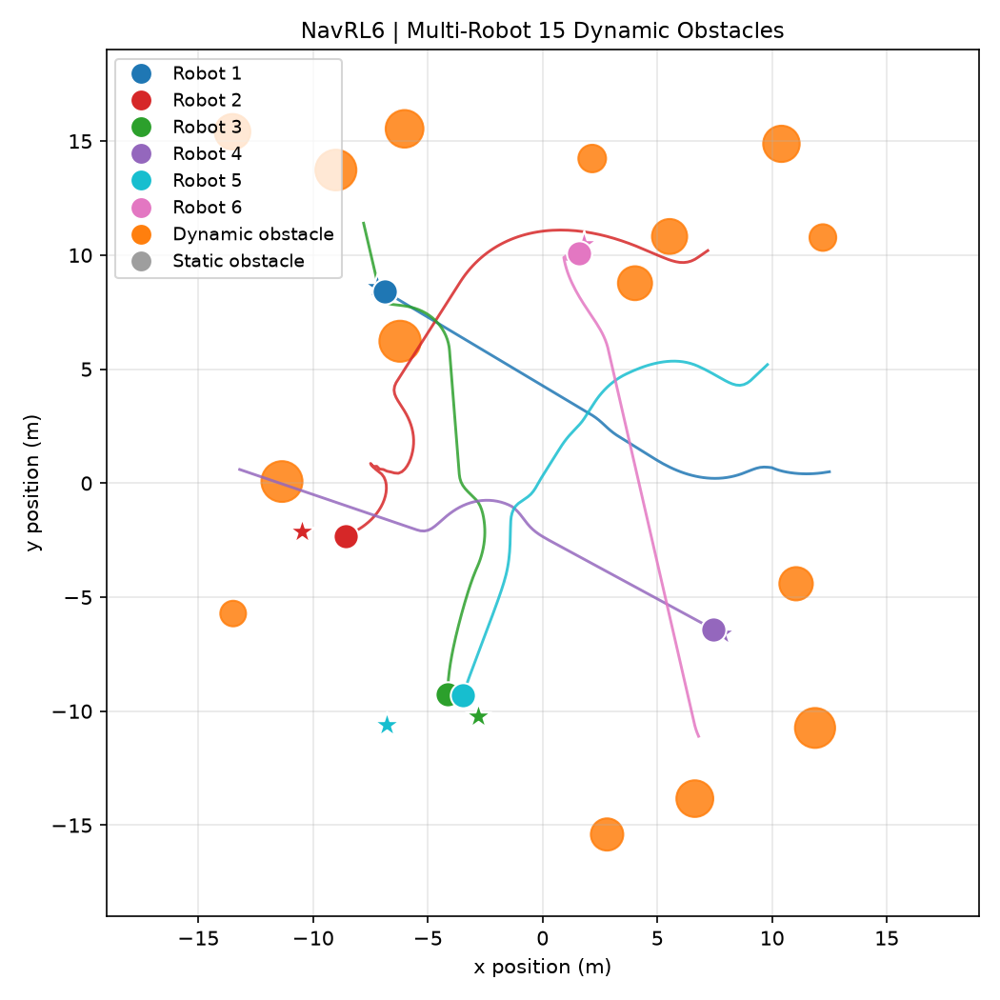
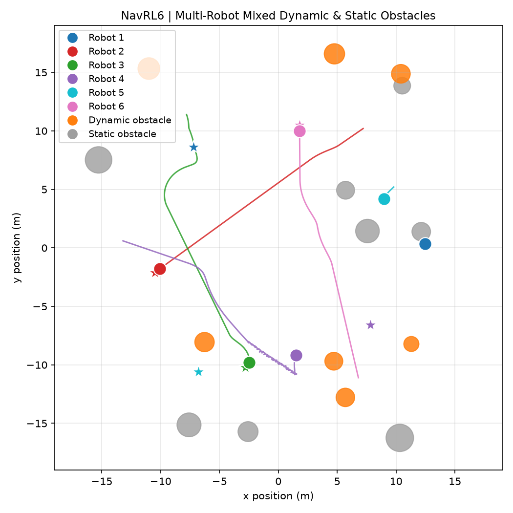
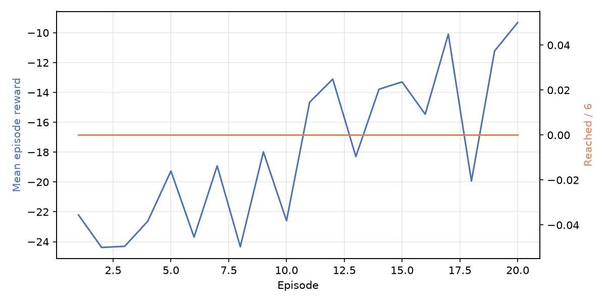

# NavRL6 — Six-Robot Reinforcement-Learning Navigation

A multi-robot navigation benchmark in which **6 holonomic robots** learn to
reach their individual goal stars while avoiding **15 obstacles** under three
obstacle configurations: **static**, **dynamic**, and **mixed**. The project
contains the environment, the reward function, a PPO actor–critic neural
network, training / evaluation code, performance metrics, visualisation, and a
full unit-test suite.

> Course assignment — Multi-robot navigation with reinforcement learning.
> Reference simulation videos are stored under [`videos/`](videos/).

---

## 1. Repository structure

```
NavRL6-MultiRobot-Navigation/
├── navrl6/                     # Python package
│   ├── __init__.py
│   ├── config.py               # World, reward and PPO hyper-parameters
│   ├── scenarios.py            # Fixed robot start / goal pairs
│   ├── obstacles.py            # Static / dynamic circular obstacles
│   ├── environment.py          # MultiRobotNavEnv (Gym-style API)
│   ├── reward.py               # Shaped multi-term reward function
│   ├── networks.py             # Actor–critic MLP (PyTorch)
│   ├── agent.py                # PPO agent and rollout buffer
│   ├── trainer.py              # PPO training loop
│   ├── evaluation.py           # Rollout runner + potential-field baseline
│   ├── metrics.py              # Success / collision / SPL / clearance metrics
│   ├── visualization.py        # Arena rendering, charts, MP4 recording
│   └── run.py                  # CLI: train / evaluate / record / all
├── tests/                      # pytest unit tests
│   ├── test_environment.py
│   ├── test_reward.py
│   ├── test_metrics.py
│   ├── test_networks.py
│   └── test_agent.py
├── results/                    # Generated metrics and figures
│   ├── metrics.csv
│   ├── metrics.md
│   └── figures/
├── videos/                     # Reference simulation videos
├── requirements.txt
└── README.md
```

---

## 2. Scenarios (assignment point 1)

All scenarios share the same 2-D square arena, `[-18, 18] m`, the same six
robot start positions and goal stars, a time step `dt = 0.10 s`, and an episode
horizon of 160 steps.

| Scenario | Robots | Static obstacles | Dynamic obstacles | Reference video |
|---|---:|---:|---:|---|
| **Static** (`static`) | 6 | 15 | 0 | [`videos/NavRL6_S1_Static.mp4`](videos/NavRL6_S1_Static.mp4) |
| **Dynamic** (`dynamic`) | 6 | 0 | 15 | [`videos/NavRL6_S2_Dynamic.mp4`](videos/NavRL6_S2_Dynamic.mp4) |
| **Mixed** (`mixed`) | 6 | 8 | 7 | [`videos/NavRL6_S3_Mixed.mp4`](videos/NavRL6_S3_Mixed.mp4) |

* **Static obstacles** — fixed grey disks (radius 0.70–1.20 m).
* **Dynamic obstacles** — orange disks (radius 0.55–0.95 m) that move at a
  constant speed of 0.90 m/s and bounce off the arena walls.
* **Mixed** — eight static and seven dynamic obstacles in the same arena.

### Robot start / goal assignment

| Robot | Colour | Start (m) | Goal (m) |
|---|---|---|---|
| 1 | blue    | (12.5, 0.5)   | (-7.2, 8.6)  |
| 2 | red     | (7.2, 10.2)   | (-10.5, -2.1) |
| 3 | green   | (-7.8, 11.4)  | (-2.8, -10.2) |
| 4 | purple  | (-13.2, 0.6)  | (7.8, -6.6)  |
| 5 | cyan    | (9.8, 5.2)    | (-6.8, -10.6) |
| 6 | pink    | (6.8, -11.1)  | (1.8, 10.5)  |

### Observation space (per robot, 12 dimensions)

| Dim | Content |
|---|---|
| 0–1 | Goal relative vector `(goal − robot)` (m) |
| 2 | Euclidean goal distance (m) |
| 3–4 | Robot velocity `(vx, vy)` (m/s) |
| 5–6 | Nearest obstacle relative vector (m) |
| 7 | Nearest obstacle free-space distance (m) |
| 8–9 | Nearest other robot relative vector (m) |
| 10 | Nearest other robot free-space distance (m) |
| 11 | Fraction of episode steps remaining |

### Action space (per robot, 2 dimensions)

Continuous velocity command `(vx, vy)`, clipped to a maximum speed of
2.0 m/s.

---

## 3. Reward function (assignment point 2)

The per-robot reward is a weighted sum of interpretable terms. Goal-seeking
terms are **positive**; safety, effort and time-waste terms are **negative**.

$$
r = w_p(d_{prev}-d) + B_{\text{goal}} - C_{\text{coll}}
- \lambda_c \max(0, \tfrac{m-c}{m})
- \lambda_s \max(0, \tfrac{b-s}{b})
- c_t - \lambda_u \lVert a \rVert^2
$$

### Reward term table

| # | Term | Formula | Sign | When it is given | Weight |
|---|---|---|---|---|---:|
| 1 | **Progress** (goal-distance shaping) | `w_p · (d_prev − d)` | **+** when the robot approaches the goal; **−** when it moves away | Every transition | 1.50 |
| 2 | **Goal bonus** | `+B_goal` | **+** one-off large reward when the robot enters the goal radius (0.55 m) | Goal reached | +100.0 |
| 3 | **Collision penalty** | `−C_coll` | **−** on contact with an obstacle, another robot, or a wall | Collision detected | −10.0 |
| 4 | **Clearance penalty** | `−λ_c · max(0, (m−c)/m)` | **−** linear penalty inside the 1.20 m safety margin around obstacles | Free space `c < 1.20 m` | −0.80 |
| 5 | **Separation penalty** | `−λ_s · max(0, (b−s)/b)` | **−** when another robot enters the 1.30 m separation band | Robot-robot free space `s < 1.30 m` | −0.50 |
| 6 | **Time penalty** | `−c_t` | **−** small constant per-step cost, discouraging slow / wandering solutions | Every step | −0.01 |
| 7 | **Control effort** | `−λ_u · ‖a‖²` | **−** quadratic action cost, encouraging smooth, low-jitter motion | Every action | −0.05 |

**Design intent.** The progress term gives dense feedback even before the goal
is reached; the goal bonus makes success clearly rewarding; collision,
clearance and separation terms enforce safety; the time and control terms
encourage efficient and smooth trajectories. Every component is recorded in
`reward_breakdown` so it can be inspected per step (see
`navrl6/reward.py`).

---

## 4. Neural network and hyper-parameters (assignment point 4)

### Network identification

* **Policy family:** Proximal Policy Optimization (**PPO**), a clipped
  on-policy actor–critic RL algorithm.
* **Network type:** a **feed-forward fully-connected Multi-Layer Perceptron
  (MLP)** with two separate heads:
  * **Actor (policy) head** — outputs the mean of a diagonal Gaussian
    distribution over the 2-D velocity command; the standard deviation is a
    learnable parameter. The mean is passed through `tanh` and scaled by the
    maximum speed.
  * **Critic (value) head** — outputs a scalar state-value estimate `V(s)`.
* **Shared policy:** the same network controls all six robots (homogeneous
  multi-agent policy); transitions from every robot are pooled into one PPO
  buffer.

### Architecture

| Component | Specification |
|---|---|
| Input (observation) dim | 12 |
| Action dim | 2 |
| Hidden layers | 2 hidden layers, 128 units each |
| Activation | ReLU (actor and critic) |
| Actor output | `tanh` mean + learnable log-std, diagonal Gaussian |
| Critic output | Linear scalar value |

### Training hyper-parameters

| Hyper-parameter | Value |
|---|---:|
| Actor learning rate | 3 × 10⁻⁴ |
| Critic learning rate | 1 × 10⁻³ |
| Discount factor `γ` | 0.99 |
| GAE `λ` | 0.95 |
| PPO clip ratio `ε` | 0.20 |
| PPO optimisation epochs per rollout | 10 |
| Mini-batch size | 64 |
| Rollout steps per update | 2048 |
| Entropy coefficient | 0.01 |
| Value loss coefficient | 0.50 |
| Max gradient norm | 0.50 |
| Initial log-std | −0.5 |
| Optimiser | Adam |

Source: [`navrl6/networks.py`](navrl6/networks.py),
[`navrl6/agent.py`](navrl6/agent.py), [`navrl6/config.py`](navrl6/config.py).

---

## 5. Performance metrics and evaluation (assignment point 3)

### Metric definitions

| Metric | Definition | Better |
|---|---|:---:|
| **Success rate** | Fraction of robots that reached their goal | ↑ |
| **Collision rate** | Fraction of robots that collided | ↓ |
| **Avg. steps** | Mean decision steps to goal (or timeout) | ↓ |
| **Path length** | Travelled arc length (m) | ↓ |
| **Avg. min. clearance** | Mean smallest free space to any obstacle (m) | ↑ |
| **Avg. episode reward** | Mean accumulated return per robot | ↑ |
| **SPL** | Success-weighted path length: `(1/N) Σ S_i · D_i / max(P_i, D_i)` | ↑ |

`D_i` is the straight-line start-to-goal distance and `P_i` the travelled path
length. SPL rewards reaching the goal via a short path.

### Evaluation results

The table below summarises the **reactive potential-field baseline**
(`ReactivePolicy`) over 10 episodes × 6 robots per scenario
(60 robot rollouts per scenario). Full data: [`results/metrics.csv`](results/metrics.csv),
[`results/metrics.md`](results/metrics.md).

| Scenario | Success rate ↑ | Collision rate ↓ | Avg. steps ↓ | Path length (m) ↓ | Min. clearance (m) ↑ | Avg. reward ↑ | SPL ↑ |
|---|---:|---:|---:|---:|---:|---:|---:|
| Static  | 0.533 | 0.150 | 160.0 | 22.39 | 1.671 | 56.64 | 0.501 |
| Dynamic | 0.717 | 0.117 | 157.9 | 22.93 | 1.828 | 77.32 | 0.671 |
| Mixed   | 0.700 | 0.117 | 158.7 | 22.51 | 1.793 | 75.65 | 0.654 |

### Figures

**Scenario comparison** — success rate, collision rate, SPL and minimum
clearance across the three scenarios:



**Representative trajectories**

| Static | Dynamic | Mixed |
|---|---|---|
|  |  |  |

**PPO smoke-training curve** (20 episodes, mixed scenario; CPU). Mean episode
return improves from ≈ −24 to ≈ −9; longer training (`--episodes 200`) is
required for the policy to reach the goals consistently.



---

## 6. Installation

```bash
# Python 3.10+ (developed on Ubuntu 22.04 / Windows, CPU-friendly PyTorch)
python -m venv .venv
source .venv/bin/activate        # Windows: .venv\Scripts\activate
pip install -r requirements.txt
```

## 7. Usage

```bash
# Run the unit test suite
python -m pytest tests/ -v

# Evaluate the baseline policy on all scenarios (writes results/)
python -m navrl6.run evaluate --episodes 10

# Train the PPO agent on one scenario
python -m navrl6.run train --scenario mixed --episodes 200

# Record a navigation video (MP4, ffmpeg backend)
python -m navrl6.run record --scenario static --out videos/demo_static.mp4

# Full pipeline: evaluate + smoke training + all figures
python -m navrl6.run all
```

### Programmatic API

```python
from navrl6 import MultiRobotNavEnv, ReactivePolicy, evaluate_scenario, summarize

env = MultiRobotNavEnv(scenario="mixed", seed=0)
records = evaluate_scenario("mixed", ReactivePolicy(), episodes=10)
stats = summarize("mixed", records)
print(stats.success_rate, stats.spl)
```

---

## 8. Tests

The test suite covers the environment, reward function, metrics, neural
network and PPO agent:

| Test file | Covers |
|---|---|
| `tests/test_environment.py` | Observation/action shapes, obstacle counts per scenario, goal/collision/wall detection, speed clipping, determinism |
| `tests/test_reward.py` | Positive/negative progress, goal bonus, collision, clearance, separation, time and control terms, breakdown keys |
| `tests/test_metrics.py` | Path length, SPL, aggregation, Markdown / CSV export |
| `tests/test_networks.py` | Forward / evaluate shapes, back-propagation, tanh bounds, model construction |
| `tests/test_agent.py` | Action shape and speed, PPO update step, checkpoint save/load round-trip |

Run:

```bash
python -m pytest tests/ -v
```

---

## 9. Reproducibility

* Every scenario is built from a seeded NumPy generator (`seed=0` by default);
  obstacle layouts are reproducible.
* Robot start and goal positions are fixed in
  [`navrl6/scenarios.py`](navrl6/scenarios.py).
* Reference videos in [`videos/`](videos/) show the three target scenarios.

---

*Author: LIU YONGFU (20263321) — NavRL6 multi-robot navigation assignment.*
